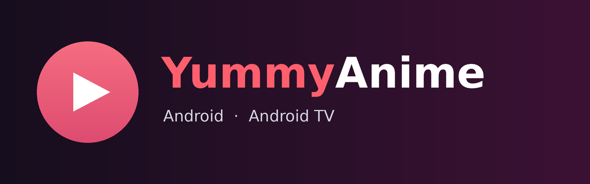
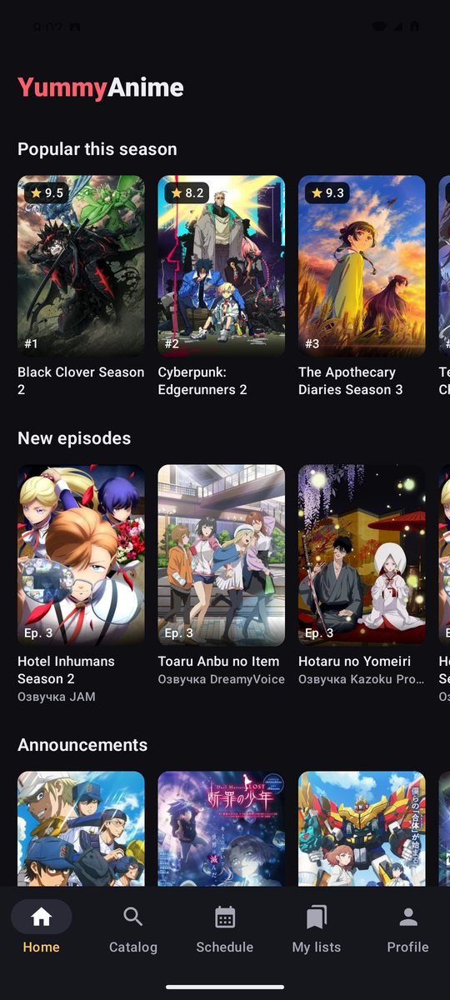
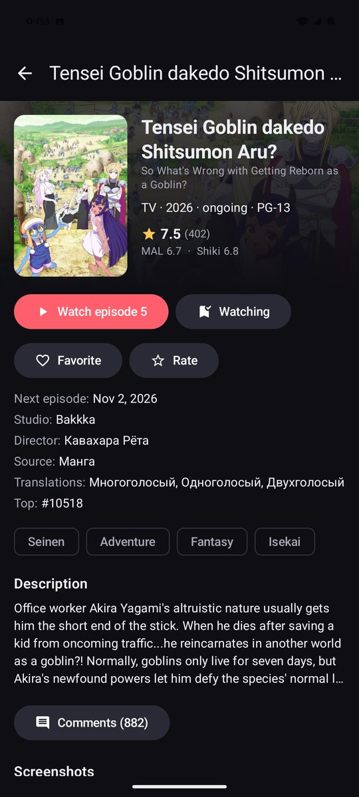
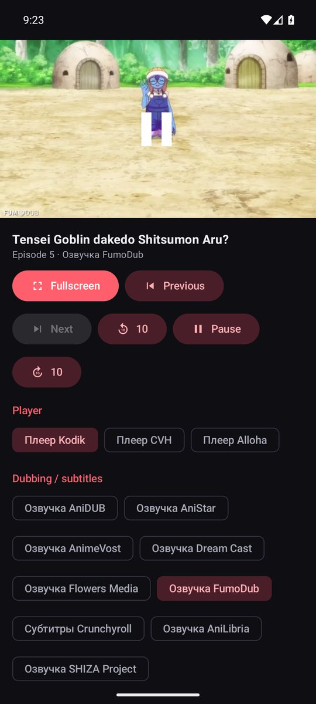
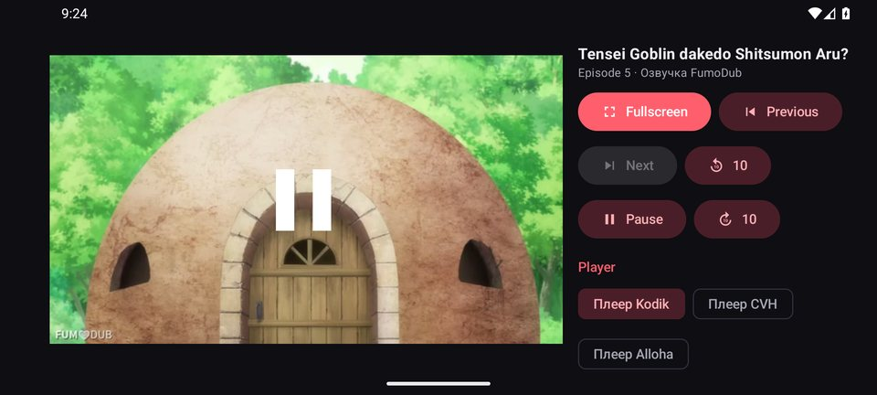
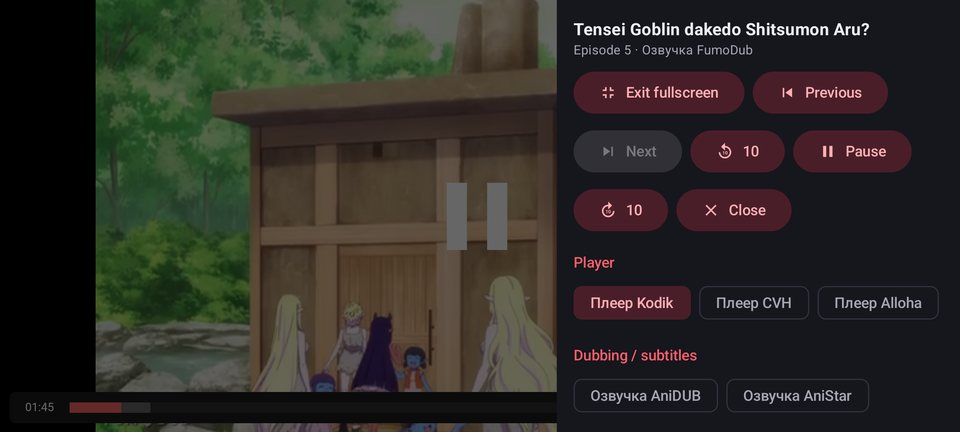
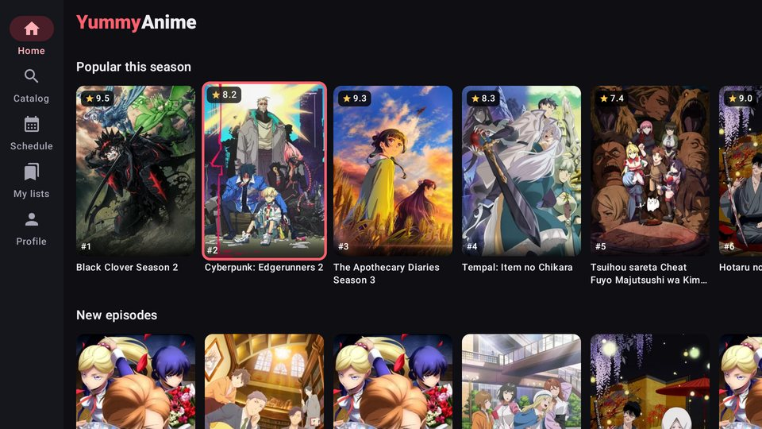
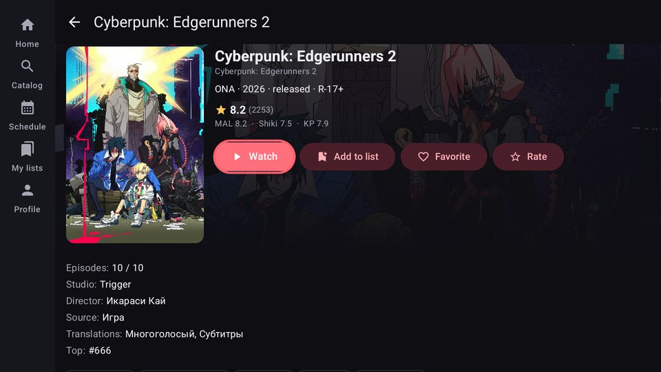
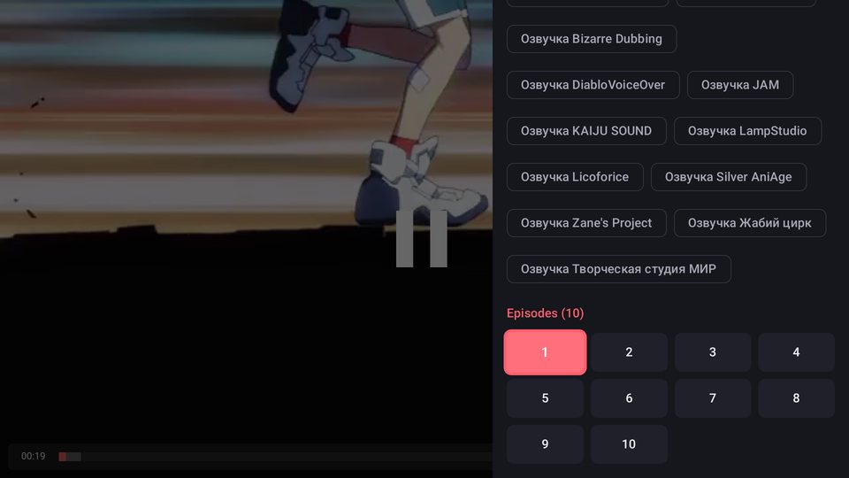

<p align="center">
  
</p>

<p align="center">
  <a href="https://github.com/russkiy78/yummyanime-android/releases/latest"></a>
  <a href="https://github.com/russkiy78/yummyanime-android/actions/workflows/release.yml"></a>
  
  
  <a href="LICENSE"></a>
</p>

An unofficial Android and Android TV client for [yummyani.me](https://yummyani.me).
Browse the catalog, manage your lists and watch anime in any of the site's players, switching between dubbings and subtitles.
One APK runs on phones, tablets and TVs, in portrait and landscape, windowed or fullscreen.

## Download

Get the APK from [**Releases**](https://github.com/russkiy78/yummyanime-android/releases/latest).
Every commit to `main` builds and publishes a new version automatically.

- **Phone or tablet:** download `YummyAnime-<version>.apk`, open it and allow installing apps from this source.
- **Android TV:** run `adb install -r YummyAnime-<version>.apk`, or copy the file to the TV (for example with Send Files to TV) and install it with a file manager.
- Updates install over the previous version and keep your login and settings.

## Screenshots

| Home | Anime page | Player |
|---|---|---|
|  |  |  |

| Landscape, windowed | Fullscreen with the episode panel |
|---|---|
|  |  |

**Android TV**

| Home | Anime page | Player panel |
|---|---|---|
|  |  |  |

## Features

- **Account.** Log in with your email or nickname (with hCaptcha when the server asks for it); the session token is refreshed automatically.
- **Home.** Continue watching, popular this season, new episodes, recommendations, announcements, recently added and collections.
- **Catalog and search.** Sorting and filters by type, status, translation, years and genres; hide titles that are already in your lists.
- **Anime page.**
  - Description, ratings (YummyAnime, MyAnimeList, Shikimori, Kinopoisk), studio, director, viewing order, screenshots and similar titles.
  - Your list status (Watching, Plan to watch, Completed, On hold, Dropped), favorites and a 1–10 rating.
  - A "Continue episode N" button based on your progress.
- **More.** Your lists, watch history, airing schedule by day, collections, notifications and comments (read, replies, posting).
- **Player.**
  - Kodik, CVH, Alloha and Aksor players, with switching of player, dubbing, subtitles and episode.
  - Resumes where you stopped and syncs progress with your account, just like the website.
  - Skip the opening with one press or automatically; play the next episode automatically.
  - Portrait, landscape windowed (video and panel side by side) and fullscreen modes. Switching modes does not reload the video.
- **Android TV.** Leanback launcher banner, remote navigation with a clear focus highlight, side navigation rail, full player control from the remote.
- **Languages.** English and Russian interface; titles and descriptions from the API follow the interface language.

### Remote control in the player

| Button | Fullscreen | Windowed |
|---|---|---|
| OK | Play / pause; skips the opening while the hint is shown | Same, when the video has focus |
| ◀ ▶ | Seek 10 s (hold for 30 s and 60 s steps) | Move focus between the video and the panel |
| ▲ ▼ / Menu | Open the episode, dubbing and player panel | Navigate the panel |
| Back | Close the panel, then leave the player | Leave the player |
| Media keys, CH+ / CH− | Play / pause, seek, next and previous episode | Same |

In windowed mode the panel also has −10 s, play / pause, +10 s and fullscreen buttons.
Remote seeking works in Kodik, CVH and Alloha. Aksor has no control API, so OK taps the middle of the video instead.

## How it works

- **Data** comes from the official YummyAnime API at `https://api.yani.tv` ([documentation](https://api.yani.tv/swagger)).
- **Video** plays in the same embedded players the website uses.
  - The wrapper page is loaded with the `https://yummyani.me` origin, because some players (Alloha) refuse other origins.
  - Player events (time, duration, pause, episode end) reach the app through `postMessage`.
  - Play, pause and seek commands go back the same way.

```
app/src/main/java/com/yani/client/
  data/      API client (OkHttp + kotlinx.serialization), models, session and settings, player and episode selection
  ui/        Jetpack Compose screens: home, catalog, anime, lists, schedule, collections, profile
  player/    PlayerActivity: WebView player host, postMessage adapters, progress sync, screen modes
```

Stack: Kotlin 2.4, Jetpack Compose (Material 3), Navigation Compose, OkHttp 5, kotlinx.serialization, Coil 3, AndroidX WebKit.

## Building

You need JDK 17+ and the Android SDK with platform 37. The SDK path goes into `local.properties` (Android Studio creates it for you).

```bash
./gradlew assembleDebug      # app/build/outputs/apk/debug/app-debug.apk
./gradlew assembleRelease    # app/build/outputs/apk/release/app-release.apk (minified, about 2.3 MB)
```

Without a signing key the release build is signed with the debug key. To sign with your own key, add this to `~/.gradle/gradle.properties`:

```properties
yummy.keystore.file=/path/to/release.jks
yummy.keystore.password=...
yummy.key.alias=...
yummy.key.password=...
```

### Application token (X-Application)

The API documentation asks every app to send its own public token in the `X-Application` header.
You can create one at https://yummyani.me/dev/applications. The API currently works without it. To set a token:

- at build time, pass `-Pyummy.appToken=...` (or set the `YUMMY_APP_TOKEN` secret in CI);
- in the app, go to Profile → Settings → API.

## Releases and CI

The [`.github/workflows/release.yml`](.github/workflows/release.yml) workflow runs on every push to `main`, except documentation-only changes.
You can also start it manually from the Actions tab. It does three things:

1. Builds a signed release APK versioned `<yummy.version>.<build number>`, for example `1.0.12`. The base version lives in `gradle.properties`.
2. Creates the `v1.0.12` tag and a GitHub release with `YummyAnime-1.0.12.apk` attached.
3. Writes release notes with the commits since the previous release, installation steps, and the SHA-256 of the APK and of the signing certificate.

Repository secrets (Settings → Secrets and variables → Actions):

| Secret | Value |
|---|---|
| `YUMMY_KEYSTORE_BASE64` | The keystore, base64-encoded (`base64 -w0 release.jks`) |
| `YUMMY_KEYSTORE_PASSWORD` | Keystore password |
| `YUMMY_KEY_ALIAS` | Key alias |
| `YUMMY_KEY_PASSWORD` | Key password |
| `YUMMY_APP_TOKEN` | Optional X-Application token |

Without the signing secrets (for example in a fork) the workflow still builds the APK and attaches it to the run as an artifact,
but it does not publish a release.

## Limitations

- **Ads.** Players such as Kodik show their own ads before an episode, the same as on the website.
  The "skip ad" button inside the player cannot be reached with a TV remote, so the ad simply plays to the end.
- **Not implemented yet:**
  - private messages, friends, reviews, posts and news, blogger videos;
  - profile editing and registration (the app links to the website for sign-up);
  - login with VK, Telegram, Shikimori or Discord.

## Disclaimer

This is an unofficial project and is not affiliated with YummyAnime.
The app does not host or distribute any video:
- the catalog comes from the public YummyAnime API;
- videos are shown by third-party players, exactly as on the website.

The API documentation allows personal use only; contact the YummyAnime owners about commercial use.
All anime, posters and descriptions belong to their respective rights holders.

## License

[MIT](LICENSE)
